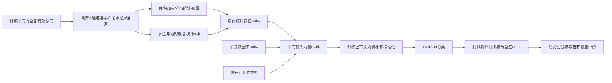

# 三峡库区滑坡易发性：V3阶段汇报

2026-10-22。基于已完成结果；正在运行的因子解释暂不纳入结论。

## 1. 模型与像元统计

**样本：** 25,509个斜坡单元，其中清单滑坡661个（2.59%）；其余为未标注单元，不能直接认定无滑坡。“维”就是一个输入数值，“通道”就是每个像元的一类属性。

**模型怎么用：** 先把一块坡内的全部有效像元汇总成44个数，再拼成84维输入。TabPFN是预训练表格分类器，利用训练单元及其标签给测试单元评分。“训练上下文”指每次选用的4,000个训练样本；“OOF”指只用未训练过该单元所在折的模型给它评分，再拼成全区结果。

### 1.1 8个像元通道

|类别|内容|计算含义|
|---|---|---|
|地形4维|高程、坡度、坡向sin/cos|坡向用正弦、余弦表达，避免359°与1°被误判为相差很远；平坦像元两项为0|
|水位4维|淹没频率、相对水位P10/P50/P90|用匹配水文站事件前水位和像元高程计算|

像元i的高程为zᵢ，事件前T天水位为Hₜ，则：

$$
f_i=\frac{\sum_{t=1}^{T}\mathbf{1}(H_t\ge z_i)}{T},\qquad
r_{i,p}=\frac{z_i-Q^{\mathrm{time}}_p(H)}{30\ \mathrm{m}},\quad p=0.1,0.5,0.9
$$

f是被水位覆盖的天数比例；**1(条件)**在条件成立时记1，否则记0；Qᵗⁱᵐᵉ是水位按天排列的时间分位数。r表示像元比相应水位高多少，除以30米统一尺度。长期缺测保留为缺失，不记作“未淹没”。

### 1.2 40维分布统计＋4维联合统计

像元面积为aᵢ，权重为wᵢ；某通道像元值为xᵢ：

$$
w_i=\frac{a_i}{\sum_j a_j},\qquad
\mu_x=\sum_iw_ix_i,\qquad
\sigma_x=\sqrt{\sum_iw_i(x_i-\mu_x)^2}
$$

**Σ表示求和。** μ是面积加权平均，σ是离散程度；面积越大的像元占比越高。像元面积按实际网格计算，经纬度网格采用椭球面积。

把x从小到大排列，累计权重首次达到p时取该值：

$$
Q^{\mathrm{space}}_p=x_{(k)},\qquad
k=\min\left\{k:\sum_{j=1}^{k}w_{(j)}\ge p\right\},\quad p=0.1,0.5,0.9
$$

Qˢᵖᵃᶜᵉ的P10/P50/P90表示坡内较低、中间、较高水平，不作插值。它与水位的**时间分位数**不同，是像元间的**空间分位数**。

|统计部分|计算|维数|
|---|---|---:|
|8通道的分布|每通道取μ、σ、P10、P50、P90|40|
|水位—地形联合|淹没加权坡度、加权坡向sin/cos、淹没频率与坡度协方差|4|

联合量公式：

$$
J_q=\frac{\sum_iw_if_iq_i}{\max(\mu_f,10^{-8})},\quad q_i\in\{s_i,\sin\theta_i,\cos\theta_i\};\qquad
J_{cov}=\sum_iw_i(f_i-\mu_f)(s_i-\mu_s)
$$

s是坡度，θ是坡向，μf/μs是平均淹没频率/坡度。前三项看常淹没部分的陡缓、方向；协方差看淹没频率和坡度是否同时偏高或偏低。分母下限用于避免除零；完整记录下全坡未淹没时，前三项为0，不表示坡度为0。

**示例（非实验结果）：** 坡度10°、20°、30°，面积占比20%、30%、50%，得到均值23°、标准差7.81°，P10/P50/P90为10°/20°/30°。均值描述总体，离散程度和分位数补充坡内差异。

**具体怎么汇总：** 若一块坡有10个等面积像元，其中2个坡度10°、3个20°、5个30°，先算`(2×10＋3×20＋5×30)/10＝23°`。将像元按坡度排序，累计面积首次达到10%、50%、90%时取值，得到10°、20°、30°。这一步是把**全坡多个像元汇总成5个数**；对8个通道各做一次，才得到40个数。完整的8通道、40个统计值及4个联合量见[10像元逐步计算例子](../results/v3_briefing_20261022/pixel_statistics_worked_example.md)。

**最终输入：38维单元因子＋2维可用性＋44维统计＝84维。** 可用性为`ln(1+有效像元数)`与“有无有效像元”。缺失填补、标准化只使用训练上下文：缺失填训练均值，再按`(数值−训练均值)/训练标准差`缩放，避免测试数据参与处理。当前是固定统计聚合；MIL（多实例学习）学习如何把一组像元聚合成单元表征，本轮尚未采用。

## 2. 模型效果：排名、检出与面积效率

|指标|公式或含义|怎么读|
|---|---|---|
|ROC-AUC|正单元评分高于未标注单元的配对比例，同分记半分|衡量排序；0.5约为随机排序，越接近1越好|
|AP，平均精确率|AP＝Σₖ(Rₖ−Rₖ₋₁)Pₖ|从高分向低分逐步纳入单元，汇总不同召回率下的精确率，越高越好|
|C20，前20%面积覆盖率|入选范围内清单滑坡数÷全部清单滑坡数|同等面积预算能覆盖多少清单滑坡|

AP中，Pₖ（精确率）＝已选清单正单元数÷已选单元数；Rₖ（召回率）＝已选清单正单元数÷全部正单元数，k是依次放宽评分门槛的步骤。这里Pₖ表示比例，与后文FR公式中的正单元计数不同。

**三种子平均OOF结果：** 种子控制抽样等随机过程，使用42、43、44三次运行的平均评分。

主报告采用**高＋极高等级清单覆盖率**，AUC/AP仍评价连续评分。C20移为[历史补充](../results/v3_briefing_20261022/C20_historical_supplement.md)。

|协议|AUC|AP|高＋极高清单覆盖率|高＋极高面积占比|高＋极高内清单正例比例|
|---|---:|---:|---:|---:|---:|
|空间五折|0.9107|0.1831|57.03%（377/661）|10.65%|17.31%（377/2178）|
|行政五折|0.9206|0.2228|64.60%（427/661）|11.32%|18.26%（427/2338）|

上述分级数值来自现有图集的五级Jenks分类，是QGIS重新分级前的参照，不是新QGIS结果。

设某县清单滑坡单元数为P、建模面积为A；高＋极高内的清单正单元数为P_H、总单元数为N_H、面积为A_H：

$$
R_H=\frac{P_H}{P},\qquad S_H=\frac{A_H}{A},\qquad D_H=\frac{P_H}{N_H},\qquad E_H=\frac{R_H}{S_H}
$$

R_H看识别覆盖，S_H看划出多大范围，D_H看范围内清单正例比例，E_H看相对全县平均的单位面积清单富集倍数。扩大高等级范围通常也会提高覆盖，故必须将R_H和S_H一起报告。P统计的是含滑坡记录的斜坡单元，不是滑坡点数；未标注单元不能直接认定为误报。

**五级与阈值：** 等级5/4/3/2/1依次为极高/高/中/低/极低。若4个断点为b1<b2<b3<b4，则高＋极高为`score>b3`，用的是**中—高分界**；`score>b4`只有极高。本次历史空间/行政b3约0.312794/0.322639。后续以QGIS实际断点为准，不为提高覆盖而调阈值。

所有县共用同一套全区断点；县域只汇总计数与面积。430个河道规则单元不参与断点和模型评价。正式评价使用未参与训练单元的OOF评分，评价的是留出地域的分区识别能力。

**历史输入对照（辅助，C20尚未改算为五级覆盖率）**（相同分折、日期和训练上下文）：

|协议|输入|AUC|AP|C20|
|---|---|---:|---:|---:|
|空间|40维表格与可用性|0.8979|0.1780|75.49%|
|空间|48维，增加像元均值|0.8972|0.1769|75.64%|
|空间|84维，完整统计|0.9089|0.1783|80.03%|
|行政|40维表格与可用性|0.9146|0.2049|82.15%|
|行政|48维，增加像元均值|0.9145|0.2013|83.06%|
|行政|84维，完整统计|0.9200|0.2120|83.81%|

84维相对40维：空间C20增加4.54个百分点（30个正单元），AP仅增加0.00024；行政C20增加1.66个百分点（11个正单元），AP增加0.0071。增益以面积覆盖更明显，单种子对照不作统计显著结论。高AUC不等于低误报，未标注单元也不能直接当作已证实的误报。

## 3. FR与IV：不同环境条件下滑坡是否集中

**先按因子类别展示，再对组内每个特征分箱计算。** 连续量按训练上下文的分位数分箱；大量0时把0单列，非零部分再分组；离散量按取值分组。分位箱是按数值分布划出的区间，不是固定米数或角度区间。

在完整四折训练池内，N/P为全部/清单正单元数，Nₖ/Pₖ为某箱的全部/正单元数：

$$
FR_k=\frac{P_k/N_k}{P/N},\qquad IV_k=\ln(FR_k)
$$

FR是该箱清单正例比例相对总体的倍数；IV为其自然对数。FR>1、IV>0表示相对富集；FR<1、IV<0表示相对较少。例如总体正例2%、某箱6%，则FR=3、IV=1.099。

下表是各协议五折中位数，代表箱均有五折支持。**一行是一个代表特征的一个分箱，不是整组总分；重复组名不重复计算维数。** 不合并重叠训练池计数、不将组内FR/IV相加。各折边界不同，表中“低/中/高”不代表统一物理阈值。[全部84维明细](../results/v3_briefing_20261022/FR_IV_grouped_details.md)。

|因子组|该组总维数|代表特征及分箱|空间FR|空间IV|行政FR|行政IV|
|---|---:|---|---:|---:|---:|---:|
|地形|5|平均高程：最低分位|3.511|1.256|3.632|1.290|
|地形|5|平均坡度：中间分位|1.466|0.382|1.487|0.397|
|几何|2|单元面积：最高分位|1.464|0.381|1.458|0.377|
|河网|3|距水系：最近分位|3.117|1.137|3.186|1.159|
|水位|5|淹没频率：非零中间组|4.821|1.573|4.810|1.571|
|水位|5|前1月淹没天数：非零中间组|4.749|1.558|4.789|1.566|
|NDVI|2|前两年NDVI：最低分位|2.093|0.739|2.100|0.742|
|NDVI|2|前两年NDVI：最高分位|0.263|-1.336|0.283|-1.263|
|降水|8|前两年最大日雨：最高分位|0.937|-0.065|1.024|0.024|
|降水|8|前1月累计降水：较高分位B4|1.125|0.118|1.159|0.148|
|降水|8|前两年年雨量均值：最高分位|1.495|0.402|1.358|0.306|
|用地|5|建设用地比例：非零中间组|2.612|0.960|2.576|0.946|
|道路|4|距道路：零值组|1.385|0.326|1.393|0.332|
|地质土壤|4|紫色土比例：非零较高组|1.233|0.209|1.250|0.223|
|地质土壤|4|J2比例：非零较低组|1.277|0.244|1.233|0.209|
|像元地形|20|坡内高程标准差：中间分位|1.377|0.320|1.513|0.414|
|像元水位|20|坡内淹没频率均值：非零中间组|4.840|1.577|4.696|1.547|
|像元联合|4|淹没加权坡度：非零中间组|4.666|1.540|4.615|1.529|
|可用性|2|有效像元数log1p：最高分位|1.458|0.377|1.471|0.386|

低高程、近水系、淹没背景代表箱IV为正；NDVI低组为正、高组为负；最大日雨最高箱接近0。它们表示清单关联，不表示模型贡献或因果效应。

零正例的原始IV为−∞，空箱/单类别层不估计；缺失和样本不足单列。程序另存平滑值（主表未使用）：

$$
IV_{k,smooth}=\ln\left[\frac{(P_k+0.5)/(N_k+1)}{(P+0.5)/(N+1)}\right]
$$

加0.5/1是避免零频率的数值处理，不代表显著性。若按县域或水位背景分层计算，N/P须改为该层数量；本表采用全训练池。

## 4. 空间有效性：换到未训练地域还能否识别

|验证|留出方法|检验内容|
|---|---|---|
|空间五折|按单元质心（几何中心）聚类成5个空间分区|从其他分区学习后，识别留出分区|
|行政五折|整县分组，同县不跨训练/测试折|从其他县学习后，识别留出县域|

每次用四折提供训练样本、一折测试，轮换五次；两套协议×五折×三种子＝30次拟合。两套都是研究区内部地域迁移，行政结果较高不代表该协议普遍更优。

**重点县域诊断：** 仅分析建模面积和清单正单元数均排前7位的云阳、涪陵、巫山、奉节、万州、忠县、丰都。共574个正单元（86.84%）、4655.26 km²建模面积（74.50%），排除小样本县域的百分比波动。

以下为中＋高＋极高，全部沿用全区统一历史断点：

|区县|建模面积km²|清单正单元|空间覆盖率|空间面积占比|行政覆盖率|行政面积占比|
|---|---:|---:|---:|---:|---:|---:|
|云阳县|1322.99|62|88.71%|18.52%|83.87%|16.88%|
|涪陵区|835.79|101|77.23%|16.70%|86.14%|23.63%|
|巫山县|687.93|73|69.86%|9.05%|91.78%|17.25%|
|奉节县|563.84|99|72.73%|16.69%|80.81%|20.15%|
|万州区|477.08|89|94.38%|26.69%|92.13%|25.44%|
|忠县|383.90|70|82.86%|40.15%|87.14%|42.04%|
|丰都县|383.71|80|82.50%|19.69%|88.75%|21.44%|

**差异判断：** 忠县两套AUC均约0.83，需约40%—42%面积覆盖83%—87%，县内区分偏弱；巫山两套AUC均约0.94—0.95，但覆盖差异大，先查评分尺度与全区阈值；万州覆盖高但范围较大，云阳、丰都以约17%—21%面积覆盖83%—89%。涪陵、奉节的覆盖变化也伴随面积变化，不直接据此判优。

具体环境线索和后续检查见[重点七县差异分析](../results/v3_county_diagnostics_20261023/重点七县差异分析.md)。县域指标只用于诊断，不按县重新分级或择优调阈值。

**淹没背景子群：** 事件前淹没频率大于0且背景已知的单元。其空间/行政AUC为0.7241/0.7578，低于全区0.9107/0.9206，组内排序仍偏弱。该子群的高＋极高覆盖率须用同一套QGIS等级另行汇总，不能直接沿用旧C20。

**正式地图：** 后续统一在QGIS用自然断点分成极高、高、中、低、极低，保存实际断点、`level`字段与工程，再按同一字段统计评价。颜色代表相对等级，不是发灾概率。[QGIS分级、评价与版式流程](V3_QGIS_GRADING_AND_EVALUATION.md)。现有图集保留，不覆盖。

## 5. 时间范围与结论

|事项|当前范围|
|---|---|
|动态因子时间|截至事件/参照月之前；水位背景从2001年起，NDVI前两年，用地前一年，降水多时间尺度|
|未标注单元参照日期|从外折训练正单元的年月分布抽取|
|长期水位缺测|每份视图约869—1,076单元背景量不完整，含17个正单元；保留缺失|
|已验证|历史回溯下的研究区内部空间/行政迁移|
|尚未验证|独立未来年份、外部区域、校准后的发灾概率|

**结论：** 历史自然断点高＋极高区约占建模面积11%，覆盖57%—65%的清单滑坡。后续以QGIS实际分级复核县域覆盖率、面积占比和范围内清单正例比例；AUC/AP保留。FR/IV解释清单关联，模型依赖待实验补充；当前结果不代表未来预警能力。

## 数据依据

- `results/v3_received_stats84/metrics.csv`、`ensemble_predictions.csv`：模型评价；全区AUC/AP/C20已从逐单元评分复算。
- `results/v3_received_controls_s42/comparison_metrics.csv`：输入对照。
- `results/v3_iv_correlation_s42/information_value_detail.csv`、`training_context_bin_plans.csv`：FR/IV及分箱。
- `results/v3_county_borders_atlas_20261021/county_selection.csv`：县域和地图面积。
- `src/v3/water_background.py`、`prepare_water.py`、`assemble.py`、`train.py`：计算方法。
